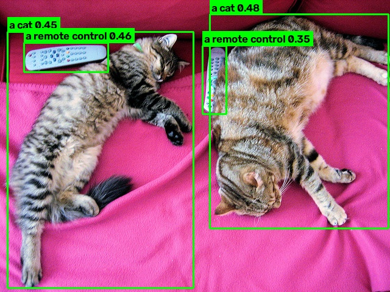
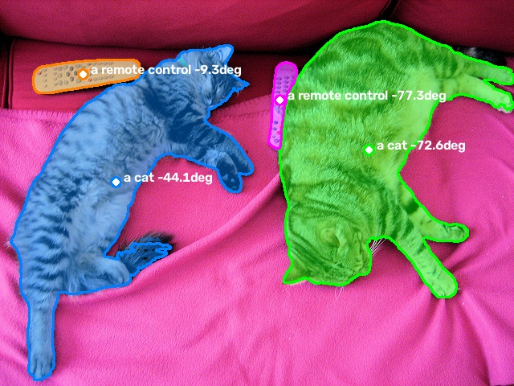

# Text-Prompted Object Detection and Segmentation API

Zero-shot object detection and segmentation from a text prompt.
Send an image and a prompt such as `"a cat. a remote control."` and get back
bounding boxes, labels and confidence scores as JSON. No training on the target objects is needed.

Built with **Grounding DINO** and **SAM** (Hugging Face Transformers), **PyTorch**, **FastAPI** and **OpenCV**.

| Detection (Grounding DINO) | Segmentation (Grounding DINO + SAM) |
|---|---|
|  |  |

## Pipeline# Text-Prompted Object Detection API

## Project structure

| File | Purpose |
|---|---|
| `detect.py` | First minimal experiment: Grounding DINO on one image |
| `detector.py` | `TextDetector` class (loads model once, `detect()` with timing, optional FP16) and `draw_detections()` |
| `run_detect.py` | Command-line tool: detect objects in one image and save the annotated result |
| `api.py` | FastAPI service: `/health`, `/detect` (JSON with timings), `/detect/image` (annotated JPEG) |
| `client.py` | Example client: calls the API, selects the best target, measures latency |
| `segmenter.py` | `BoxSegmenter` class (SAM), mask centre, orientation and area, mask drawing |
| `run_segment.py` | Command-line tool: Grounding DINO + SAM on one image |

## Setup

Tested on Ubuntu (WSL2) with an NVIDIA RTX 4050 Laptop GPU and Python 3.11.

```bash
conda create -n textdetect python=3.11 -y
conda activate textdetect
pip install -r requirements.txt
```

## Usage

**Detection from the command line**
```bash
python run_detect.py images/cats.jpg "a cat. a remote control." --threshold 0.3
```

**Detection + segmentation**
```bash
python run_segment.py images/cats.jpg "a cat. a remote control."
```

**Web API**
```bash
uvicorn api:app --port 8000
```
Interactive API docs: http://localhost:8000/docs

```bash
# example request
curl -X POST http://localhost:8000/detect \
  -F "image=@images/cats.jpg" \
  -F "prompt=a cat. a remote control." \
  -F "threshold=0.3"

# example client with latency measurement
python client.py images/cats.jpg "a cat. a remote control." --threshold 0.3 --runs 10
```

## Results

Test image: COCO `000000039769.jpg` (640 × 480), prompt `"a cat. a remote control."`, threshold 0.3.
All four objects (2 cats, 2 remote controls) were detected.

### Latency (RTX 4050 Laptop GPU, grounding-dino-tiny, via API)

| Mode | Preprocess | Model | Postprocess | End-to-end (client) |
|---|---|---|---|---|
| FP32 | – | – | – | 368 ms |
| FP16 | 17.5 ms | 251 ms | 1.7 ms | 286 ms |

- First request is ~2.3 s slower due to GPU warm-up.
- The model accounts for ~88 % of the latency, so optimisation should target inference, not the API layer.
- FP16 kept the same detections (score difference ≤ 0.01).

### Segmentation: box centre vs. mask centre

| Object | Box centre | Mask centre | Angle |
|---|---|---|---|
| Cat (right) | (491, 199) | (459, 186) | −72.6° |
| Cat (left) | (164, 262) | (144, 226) | −44.1° |
| Remote control 1 | (108, 94) | (103, 92) | −9.3° |
| Remote control 2 | (351, 131) | (348, 124) | −77.3° |

- For irregular shapes (cats), the mask centre differs from the box centre by up to ~40 px,
  so masks give a better grasp point than boxes.
- For compact, elongated objects (remote controls), the orientation angle matches the image.
- Timing on this image: detection 392 ms, SAM segmentation 349 ms (FP32).

## Author

Amitesh Tharesh Kumar, M.Eng. Mechatronics, TH Rosenheim